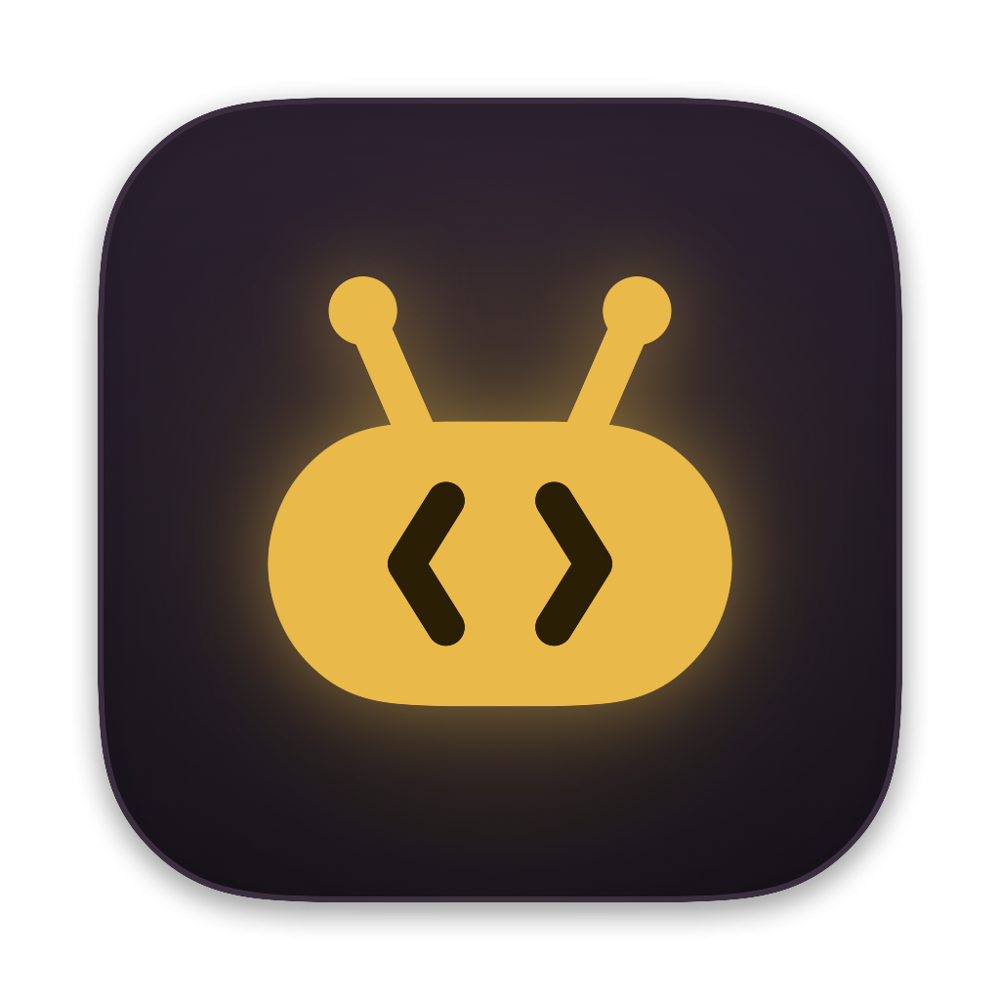
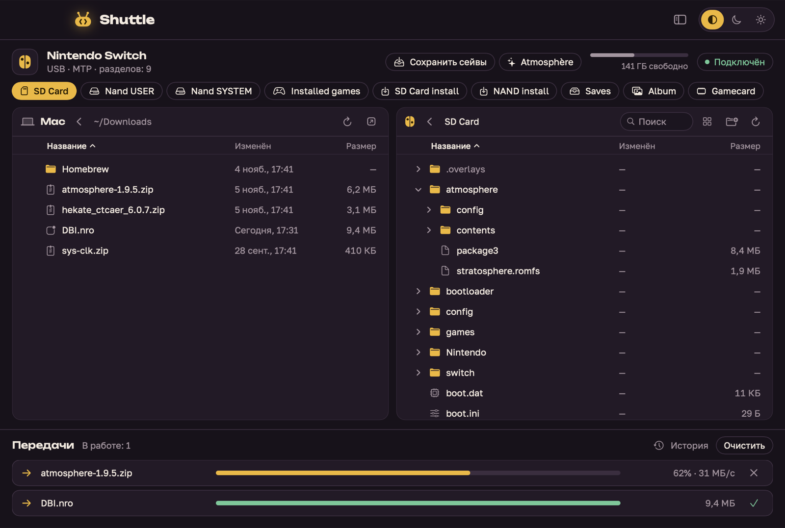

<p align="center"></p>

<h1 align="center">Wirrow</h1>

<p align="center">Drag and drop files between your Mac and an Android phone or a Nintendo Switch — over a cable.</p>



## Install

**[Download the latest version](https://github.com/Q7N3T/wirrow/releases/latest)** · [Website](https://q7n3t.github.io/wirrow/) · macOS 14+, Apple Silicon and Intel

1. Open the DMG.
2. Drag Wirrow to Applications.
3. Launch Wirrow.

> If macOS won’t open the app, go to
> **System Settings → Privacy & Security**
> and click **Open Anyway**. You only need to do this once.

## Features

- Two panes, Mac and device: drag files both ways, and from Finder
- A phone and a Switch at the same time, each in its own tab
- Every device storage as a tab; a table with sorting and expandable folders
- Transfer queue with progress and cancel; transfers resume by themselves after the cable drops
- Copies are verified after transferring
- Android: new camera photos in one click, folder sync, HEIC → JPG, previews, free up space safely
- Switch with DBI: install games, homebrew from a zip, save backups, Atmosphère updates
- Runs from the menu bar; dark and light themes; English and Russian
- Automatic updates: new versions arrive by themselves
- Wirrow the pixel mascot, with jokes and badges

[Changelog](CHANGELOG.md) · [Русский](CHANGELOG.ru.md) · [All builds](https://github.com/Q7N3T/wirrow/releases)

## Connecting

**Android:** plug in the cable and pick “File transfer” in the USB notification.

**Nintendo Switch:** put the console to sleep, plug the cable into your Mac, then wake it and choose “Run MTP responder” in DBI. If the Mac doesn’t see it, or the Switch starts charging the Mac, put the Mac on its charger first and connect the sleeping Switch again.

If the device doesn’t show up, quit Image Capture, Photos and Android File Transfer, then replug the cable.

## Building from source

```bash
brew install xcodegen pkg-config
scripts/build-deps.sh
xcodegen generate
open Wirrow.xcodeproj
```

To ship a new version: bump the version in `project.yml`, add the notes to `CHANGELOG.md` and `CHANGELOG.ru.md`, then run `scripts/release.sh`.

Wirrow is not affiliated with Nintendo or Google.
