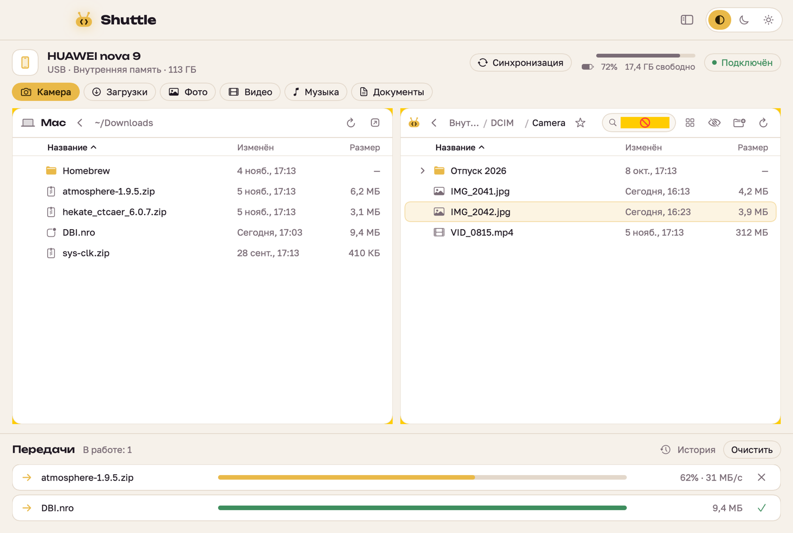
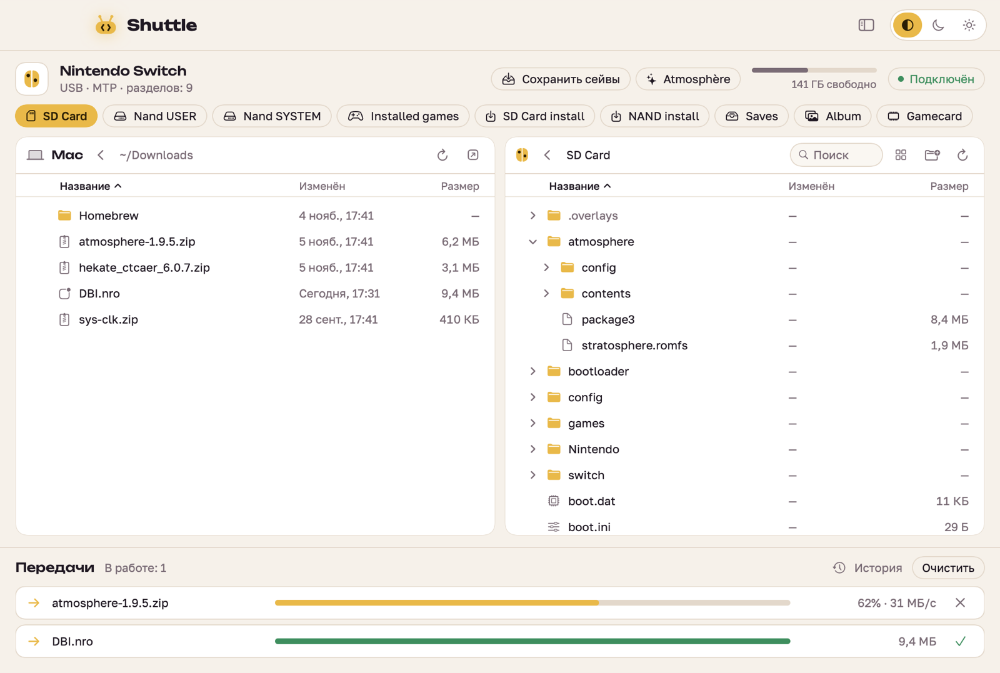

<p align="center"></p>

# Shuttle

Перетаскивание файлов между Mac и Android или Nintendo Switch по кабелю. По духу это Android File Transfer, только живой.
Работает по MTP: на телефоне не нужно включать отладку, достаточно выбрать «Передача файлов».


## Установка

1. Скачайте `Shuttle-<версия>.dmg` со страницы [Releases](../../releases).
2. Откройте DMG и перетащите Shuttle в «Программы».
3. При первом запуске macOS напишет, что не может проверить разработчика: приложение не нотаризовано.
   Откройте «Системные настройки → Конфиденциальность и безопасность» и нажмите «Всё равно открыть».
   Или в Терминале:
   ```bash
   xattr -dr com.apple.quarantine /Applications/Shuttle.app
   ```

Нужна macOS 14 или новее, на Apple Silicon или Intel. Homebrew и другие программы не нужны.

## Что умеет

- Вкладки разделов. Switch с DBI отдаёт SD Card, Nand USER, Installed games, SD Card install и другие
- Таблица с колонками «Название / Изменён / Размер», сортировка, раскрытие папок прямо в списке
- Перетаскивание в обе стороны: между панелями, из Finder на устройство, с устройства в Finder
- Файлы можно бросить прямо на папку в списке
- Очередь передач с прогрессом, скоростью и отменой
- Быстрые папки телефона: Камера, Загрузки, Фото, Видео, Музыка, Документы
- Создание папок, переименование, удаление
- Панель Mac можно скрыть, тогда устройство на всю ширину
- Тёмная и светлая темы или как в системе

## Подключение

**Android:** кабель USB → уведомление на телефоне → «Передача файлов».

**Nintendo Switch** (Atmosphère): запустите DBI → «Run MTP responder», затем подключите кабель.
Файлы `.nsp` / `.nsz`, брошенные во вкладку «SD Card install» или «NAND install», DBI сам установит.

Если устройство не находится, закройте «Захват изображений», «Фото» и Android File Transfer:
они перехватывают устройство. Потом переподключите кабель.

## Сборка

Нужны Xcode 16+ и Homebrew (только для инструментов сборки).

```bash
brew install xcodegen pkg-config
scripts/build-deps.sh      # libusb + libmtp статически, macOS 14+, arm64 + x86_64
xcodegen generate
open Shuttle.xcodeproj
```

DMG для выпуска:

```bash
scripts/make-dmg.sh        # → build/Shuttle-<версия>.dmg
```

## Шрифты

Интерфейс рассчитан на [Unbounded](https://fonts.google.com/specimen/Unbounded) (заголовки)
и [Golos Text](https://fonts.google.com/specimen/Golos+Text) (текст). Положите `.ttf` в `Resources/Fonts/`
и пересоберите. Без них используется системный шрифт.

## Устройство проекта

| Путь | Что там |
|---|---|
| `Sources/MTP/MTPService.swift` | Обёртка над libmtp, все вызовы на одной последовательной очереди |
| `Sources/AppState.swift` | Состояние: подключение, разделы, кэш папок, очередь передач |
| `Sources/Transfer.swift` | Модель одной передачи с прогрессом |
| `Sources/Views/` | Интерфейс на SwiftUI |
| `Sources/Theme.swift` | Палитра, шрифты, общие элементы |
| `Sources/Logo.swift` | Логотип, значок Joy-Con, иконка приложения |
| `scripts/` | Сборка libmtp и DMG |

Отладочные режимы (только Debug-сборка):

- `Shuttle --selftest` — прогон на подключённом устройстве: все разделы, загрузка и скачивание со сверкой SHA-256, папки, отмена, переименование, удаление. Работает во временной папке `ShuttleSelfTest` в первом разделе и убирает её за собой. Само приложение перед этим закройте.
- `Shuttle --snapshot out.png dark|light phone|switch [nomac]` — снимок окна с тестовыми данными.
- `Shuttle --icon out.png` — иконка 1024×1024.
- `Shuttle --dump-menu` — печатает строку меню.

<details><summary>Ещё скриншоты</summary>





</details>
