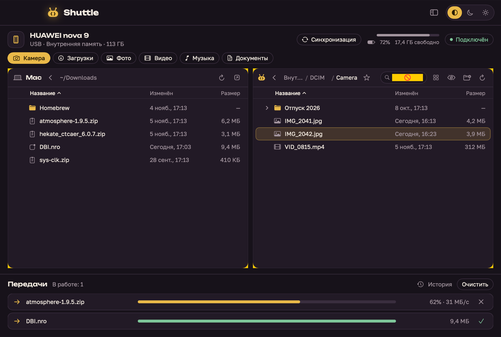

<p align="center"></p>

# Shuttle

Перетаскивание файлов между Mac и Android по кабелю — как Android File Transfer, только живой.
Работает по MTP: на телефоне не нужно включать отладку, достаточно выбрать «Передача файлов».



## Что умеет

- Две панели: Mac и Android, файлы и папки перетаскиваются в обе стороны
- Перетаскивание прямо из Finder на телефон и с телефона в Finder
- Очередь передач с прогрессом, скоростью и отменой
- Быстрые папки: Камера, Загрузки, Фото, Видео, Музыка, Документы
- Создание папок, переименование, удаление на телефоне
- Имя телефона, заряд и свободное место
- Тёмная и светлая темы (или как в системе)

## Сборка

Нужны Xcode 16+ и Homebrew.

```bash
brew install libmtp xcodegen
xcodegen generate
open Shuttle.xcodeproj
```

Или из терминала:

```bash
xcodebuild -project Shuttle.xcodeproj -scheme Shuttle -configuration Debug -derivedDataPath build/DD build
open build/DD/Build/Products/Debug/Shuttle.app
```

## Шрифты

Интерфейс рассчитан на [Unbounded](https://fonts.google.com/specimen/Unbounded) (заголовки)
и [Golos Text](https://fonts.google.com/specimen/Golos+Text) (текст). Положите `.ttf` в `Resources/Fonts/`
и пересоберите — без них используется системный шрифт.

## Если телефон не находится

1. Разблокируйте телефон и в уведомлении USB выберите «Передача файлов».
2. Закройте «Захват изображений», «Фото» и Android File Transfer — они перехватывают устройство.
3. Переподключите кабель.

## Устройство проекта

| Путь | Что там |
|---|---|
| `Sources/MTP/MTPService.swift` | Обёртка над libmtp, все вызовы на одной последовательной очереди |
| `Sources/AppState.swift` | Состояние: подключение, папки, очередь передач |
| `Sources/Transfer.swift` | Модель одной передачи с прогрессом |
| `Sources/Views/` | Интерфейс на SwiftUI |
| `Sources/Theme.swift` | Палитра, шрифты, общие элементы |
| `Sources/Logo.swift` | Логотип |

Отладочные режимы (только Debug-сборка):

- `Shuttle --selftest` — прогон на подключённом телефоне: чтение, загрузка и скачивание со сверкой SHA-256, папки, отмена, переименование, удаление. Работает во временной папке `ShuttleSelfTest` и убирает её за собой. Само приложение перед этим закройте.
- `Shuttle --snapshot out.png dark|light` — снимок окна с тестовыми данными.
- `Shuttle --icon out.png` — иконка 1024×1024.
